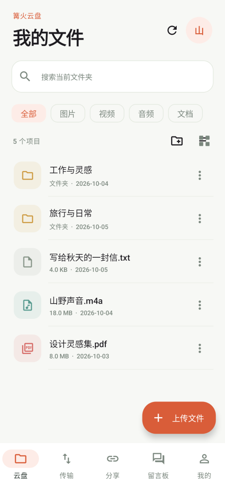
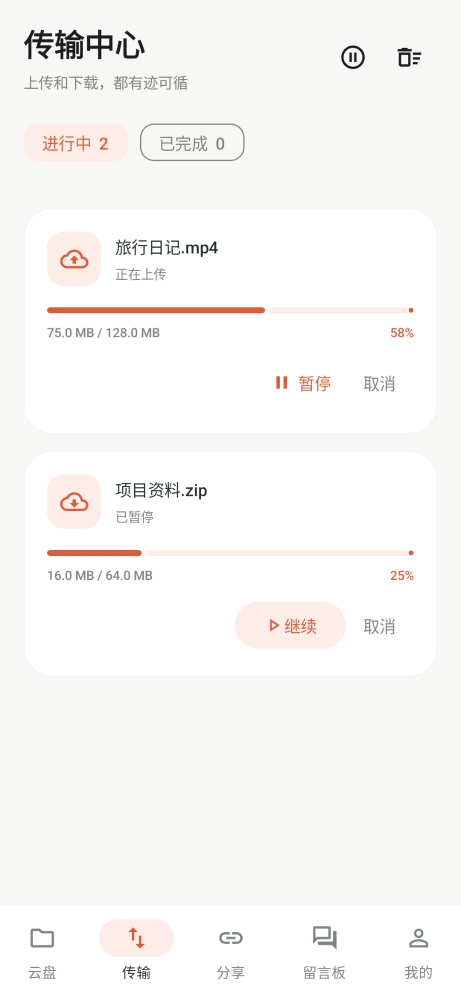
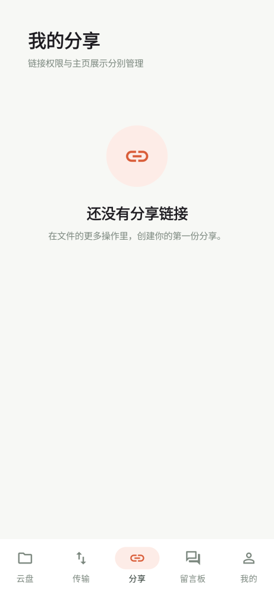
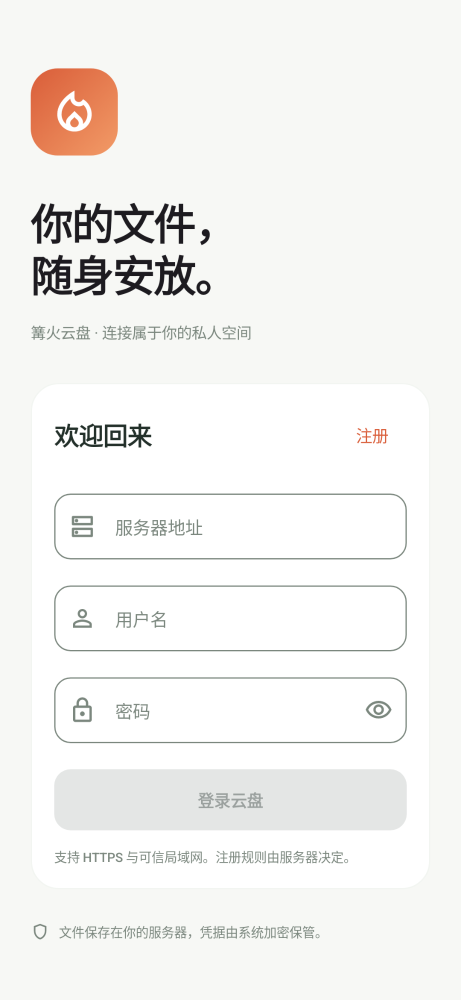

<p align="center">
  
</p>

<h1 align="center">篝火云盘</h1>

<p align="center">
  自建私有云盘的 Android 客户端<br/>
  <sub>Kotlin + Jetpack Compose Material 3 · 原生实现 · 无广告、无统计 SDK</sub>
</p>

<p align="center">
  <a href="LICENSE"></a>
  <br/>
  
  
  
</p>

<p align="center">
  配合自建的篝火云盘服务端使用，登录时填写服务器地址即可接入。
</p>

## 界面预览

<p align="center">
  
  
  
  
</p>

> 以上为 Paparazzi 渲染的界面快照（示例数据），非真机截图。

## 功能

**文件管理**

- 目录浏览、面包屑、新建文件夹、重命名、移动、批量操作
- 搜索与分类（图片/视频/音频/文档）、排序、列表/网格视图
- 回收站：恢复与彻底删除

**传输**

- 分片上传（断点续传）、下载断点续传、暂停/继续/取消
- 传输任务持久化，按服务器与账户隔离；重启、强制停止后可恢复
- 仅非计费网络传输（可选）
- 统一的传输中心：所有任务共享一张实时卡片，聚合进度、速度与剩余时间
- Android 14+ 使用系统任务调度（用户发起的传输），旧版本使用前台服务

**分享**

- 创建分享：密码、有效期、访问次数、是否公开到个人主页
- 分享详情页：头像与主页入口、在线预览（图片双指缩放、视频/音频流式播放、
  PDF 翻页、Markdown 渲染/原文切换、代码高亮）、一键下载到传输中心
- 粘贴链接查看他人分享，密码解锁

**预览**

- 图片缩放、Media3 音视频、PDF 翻页、文本/Markdown
- 预览通道经服务端内容嗅探后才允许内联渲染，可执行文件一律只能下载

**账户与社区**

- 加密会话（凭据存于系统 Keystore）、头像上传与展示、资料修改
- 密码修改、登录设备管理（显示设备名）
- 留言板与站点公告；留言提醒为系统定期轮询（约 15 分钟起，省电模式会延迟）

**更新**

- 应用内「检查更新」与「更新日志」，从服务端发布通道获取新版 APK 并校验哈希后安装

## 一些工程细节

- **上传看门狗**：`HttpURLConnection` 没有写超时，网络半死时单个分片会阻塞十几分钟并占住
  并发槽位，其他任务全部卡在「等待网络/系统调度」。看门狗按字节进展计时（60 秒无进展即
  断开走正常重试），慢速但活跃的连接不会误伤。
- **前台直跑**：系统调度器可能把已接受的用户任务压着不开工（运行时长配额、厂商省电、
  退避）。应用处于前台时任务直接在进程内执行，并由单主人锁保证不会与系统路径重复跑。
- **通知**：单色进度条 + 文件类型配图（本地 Canvas 绘制），进度刷新限频；没有引入任何
  私有厂商通知 API。
- **协议**：与服务端 `X-CSRF-Token` 双提交、分片上传、Range 下载等约定对齐；时间戳按
  服务端「北京时间」契约原样展示。

## 构建

需要 JDK 17 或 21（当前 Android Studio 自带的 JDK 25 无法运行这套 Gradle/Lint）
与 Android SDK 35：

```powershell
$env:JAVA_HOME='<你的 JDK 21 路径>'
.\gradlew.bat :app:assembleRelease :app:lintDebug
```

> 仓库默认使用**调试证书**签名，便于自用与覆盖安装；正式分发前请配置你自己的发行证书。

界面渲染测试（Paparazzi，本机渲染 Compose 页面，不需要模拟器）：

```powershell
.\gradlew.bat -PvisualQA :app:recordPaparazziDebug
```

## 项目结构

```
app/src/main/java/cn/hcy/gopan/
  Api.java                 HTTP 客户端：Cookie 会话、CSRF、超时、URL 校验
  DriveState.kt            应用状态与所有业务动作的唯一入口
  MainActivity.kt          壳与导航（底部五栏 + 页面切换动画）
  FilesPage.kt             文件列表/网格、选择、排序
  OtherPages.kt            传输中心、分享列表、留言板、回收站
  SharePage.kt             分享详情页（预览 + 下载入传输中心）
  Sheets.kt                各类底部抽屉（文件菜单、分享创建、用户主页、查看分享）
  PreviewActivity.kt       文件预览（图片缩放 / Media3 / PDF / 文本）
  Transfers.java           传输引擎：分片上传、断点续传、看门狗、前台直跑
  TaskStore.java           传输任务持久化
  Transfer*                通知卡片、前台服务、系统任务、速率估算
  Updater.kt               检查更新与更新日志
  Vault.java               凭据存储（Android Keystore 加密）
app/src/visualTest/        Paparazzi 渲染测试（-PvisualQA 时生效）
app/src/androidTest/       仪器测试（FlowTest）
```

## 许可

[MIT](LICENSE)
